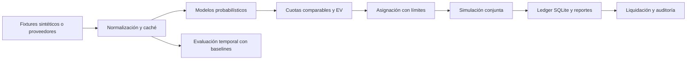

# Arquitectura

| Responsabilidad | Archivos principales |
|---|---|
| Identidad y fuentes | `entity_resolver.py`, `soccer_loader.py`, `live_odds_connector.py` |
| Modelación | `soccer_dixon_coles.py`, `pi_ratings.py`, `soccer_meta_model.py`, `nfl_epa_kalman.py`, `nba_possession_engine.py` |
| Matemáticas y exposición | `quant_core.py`, `parlay_builder.py`, `ticket_risk.py`, `master_orchestrator.py` |
| Estado y auditoría | `persistence_sync.py`, `state_registry.py`, `drift_and_weather.py` |
| Evaluación | `walk_forward.py`, `hyperparameter_tuner.py`, `examples/offline_evaluation.py` |
| Entradas | `run_daily_pipeline.py`, `run_tactical_cli.py`, `notebooks/quant_tactical_cockpit.py` |

Los módulos anteriores se encuentran en `src/`, salvo las rutas explícitas. El punto de entrada diario usa `--demo` para seleccionar fixtures deterministas y carpetas separadas. El ledger evita duplicar identificadores y conserva las liquidaciones. Los snapshots usan JSON versionado en lugar de deserializar objetos ejecutables.

Las integraciones externas se activan explícitamente por opciones de consola. La automatización pública ejecuta pruebas y ejemplos locales; no restaura datos de ninguna instalación privada. Cada clon configura su propio entorno.
